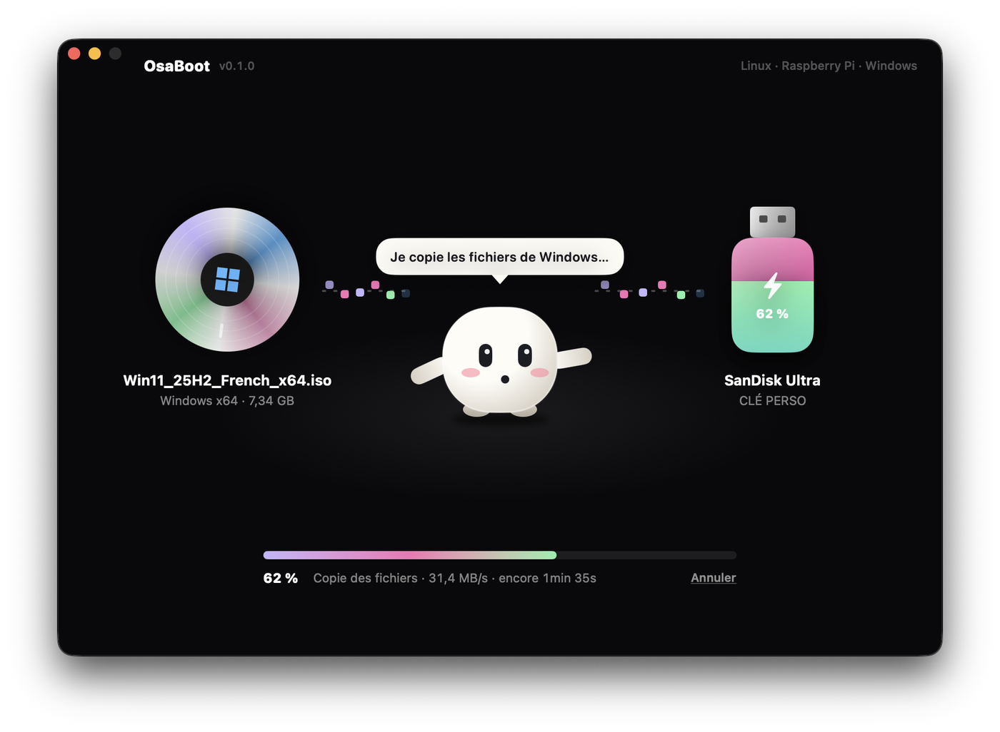
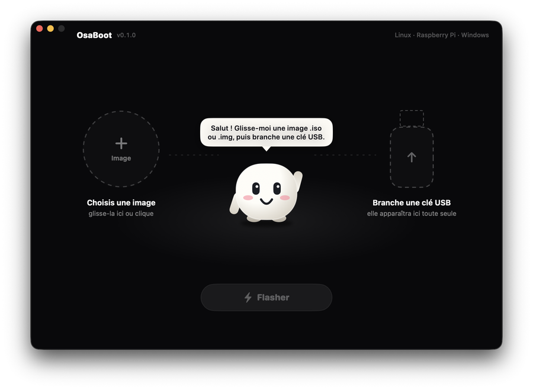
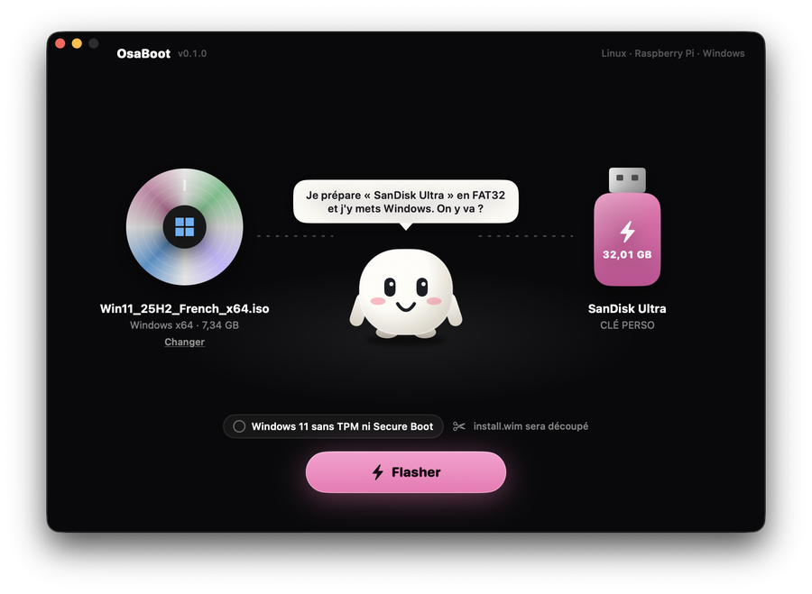
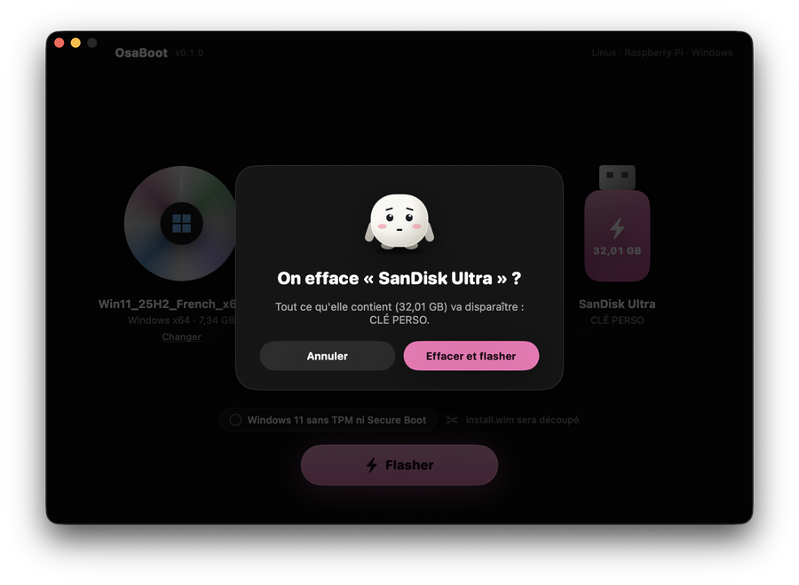
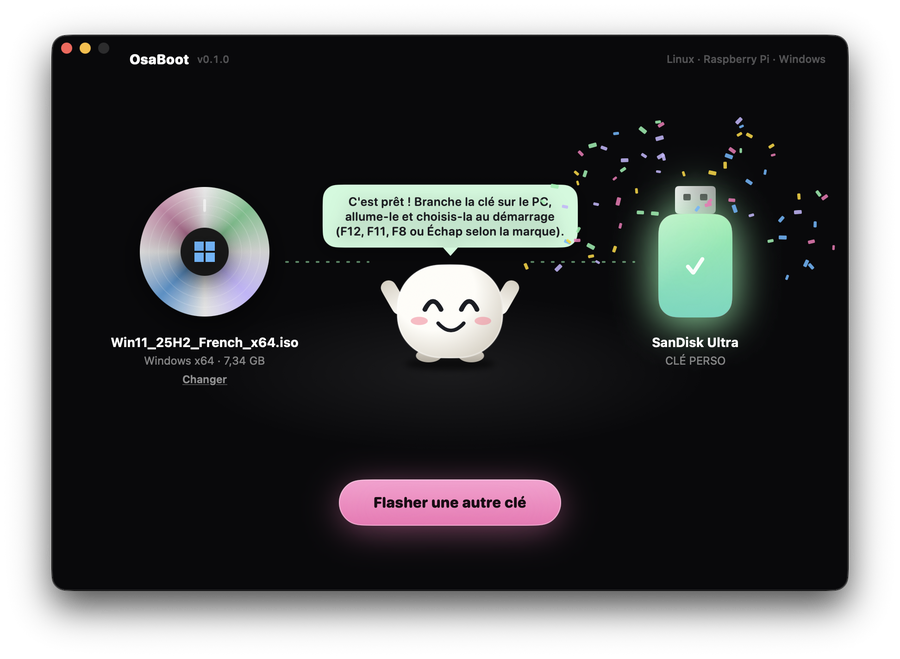

<div align="center">


# OsaBoot

### Une image, une clé USB, et c’est parti. Même pour Windows.

Copie une image `.iso` ou `.img` sur une clé USB et vérifie le résultat, comme balenaEtcher.
Et prépare aussi une **clé d’installation Windows 10 / 11** à partir d’une ISO officielle, ce qu’Etcher ne sait pas faire.


</div>

<p align="center">
  
</p>
<p align="center"><sub>Captures en mode démo (fausse ISO, fausse clé) : rien n’est écrit.</sub></p>

---

## 👋 Trois gestes

<table>
<tr>
<td width="50%"></td>
<td width="50%"></td>
</tr>
<tr>
<td><b>1. Glisse une image</b> sur la fenêtre (ou clique sur le disque). OsaBoot reconnaît tout seul un installateur Windows.</td>
<td><b>2. Branche ta clé.</b> Elle apparaît d’elle-même. Seuls les disques externes sont proposés : jamais le disque du Mac.</td>
</tr>
<tr>
<td></td>
<td></td>
</tr>
<tr>
<td><b>3. Flasher.</b> Une dernière question qui nomme la clé et ce qu’elle contient, puis on y va.</td>
<td><b>C’est prêt.</b> La mascotte te dit comment démarrer ton PC sur la clé.</td>
</tr>
</table>

## 🧸 Une mascotte qui fait le travail avec toi

Au centre de la fenêtre, la mascotte d’OsaLabs suit ta souris des yeux, fait coucou à l’ouverture, lève les bras quand tu glisses un fichier et saute quand une image ou une clé arrive. Pendant l’écriture, elle s’active, le disque tourne et des petits blocs de données voyagent jusqu’à la clé, qui se remplit au fil du pourcentage. Dans sa bulle, elle explique chaque étape (« Je relis tout pour être sûr… ») et, en cas de souci, dit ce qui ne va pas en français, sans code d’erreur.

Fond noir, animations douces, et environ **2 % de CPU** au repos : les animations qui tournent en continu ne tournent que pendant l’écriture.

## 💿 Ce que ça sait faire

| | |
|---|---|
| 🐧 **Linux, Raspberry Pi, outils** | L’image est copiée octet par octet sur la clé, puis **relue et comparée** par empreinte SHA-256. |
| 🪟 **Windows 10 / 11** | Une ISO Windows ne démarre pas si on la copie telle quelle. OsaBoot formate la clé en **FAT32 / MBR** (lisible au démarrage par tous les PC en UEFI) et y copie les fichiers. |
| ✂️ **install.wim de plus de 4 Go** | FAT32 n’accepte pas les fichiers de plus de 4 Go : OsaBoot découpe `install.wim` en `install.swm`, `install2.swm`…, que l’installateur de Windows réunit tout seul. |
| 🔓 **Windows 11 sans TPM** | En option, un `autounattend.xml` permet d’installer Windows 11 sur un PC **sans TPM 2.0 ni Secure Boot** (mêmes clés `LabConfig` que Rufus). |
| 😴 **Pas de veille** | Le Mac ne se met pas en veille pendant l’écriture. Pourcentage, vitesse et temps restant en direct. |

## 🛡️ Sécurité

- **Jamais** de disque interne, jamais le disque de démarrage, jamais une image disque montée (coffres chiffrés, simulateurs…).
- Juste avant d’effacer, la clé est relue : si elle a changé (débranchée, autre numéro), OsaBoot s’arrête.
- Si une ISO Windows doit être découpée et que l’outil manque, OsaBoot refuse **avant** de toucher à la clé.
- L’app ne tourne jamais en root. L’écriture passe par `authopen` : macOS demande ton mot de passe dans sa propre fenêtre.

## 📦 Installation

1. Télécharge `OsaBoot.dmg` depuis les [Releases](../../releases) et glisse l’app dans **Applications**.
2. Ouvre-la. L’app n’est pas notarisée : la première fois, fais **clic droit → Ouvrir**.
3. Glisse une image, branche une clé, clique sur **Flasher** (ou <kbd>⌘</kbd> <kbd>↩</kbd>).

OsaBoot regarde les [Releases](../../releases) au lancement puis toutes les 6 heures, et te propose la nouvelle version (jamais pendant une écriture).

## 🛠️ Compiler

```bash
git clone https://github.com/osayanis/osaboot.git
cd osaboot
brew install wimlib && ./scripts/vendor-wimlib-from-brew.sh   # une fois : wimlib-imagex dans vendor/
./build.sh        # → OsaBoot.app
./make-dmg.sh     # → OsaBoot.dmg
```

Sans `vendor/`, l’app utilise le `wimlib-imagex` de Homebrew s’il est installé.

### Tester sans vraie clé

Une ligne de commande reprend la même mécanique. `flash` n’accepte **que** des images disque nommées dans `OSABOOT_TEST_DISKS` :

```bash
D=$(diskutil image attach --noMount ram://204800)      # un disque de 100 Mo en mémoire
B=OsaBoot.app/Contents/MacOS/OsaBoot
$B inspect ubuntu.iso
OSABOOT_TEST_DISKS=${D#/dev/} $B flash test.img ${D#/dev/} --no-eject
OSABOOT_TEST_DISKS=${D#/dev/} OSABOOT_SPLIT_AT=10000000 $B flash win.iso ${D#/dev/}   # force la découpe
```

- `OSABOOT_TEST_DISKS=disk14 OSABOOT_IMAGE=win.iso open OsaBoot.app` ouvre l’interface en mode test.
- `OSABOOT_DEMO=1` affiche une fausse ISO et une fausse clé (rien ne peut être écrit).
- `OSABOOT_PREVIEW=confirm|working|done|failed` affiche directement un état (captures d’écran).

## ⚙️ Comment ça marche

| Étape | Technique |
|---|---|
| Trouver les clés | `diskutil list -plist external physical` + `diskutil info`, rafraîchi par DiskArbitration dès qu’un disque arrive ou part. Le disque de démarrage est exclu via ses `APFSPhysicalStores`. |
| Reconnaître l’image | Signatures lues dans le fichier (MBR `55AA`, `EFI PART`, `CD001`), puis l’ISO est montée en lecture seule pour chercher `sources/boot.wim` et `install.wim` / `install.esd`. |
| Écrire | `/dev/rdiskN` ouvert directement, sinon par `/usr/libexec/authopen` (le descripteur revient par un socket Unix). Blocs de 4 Mo, puis `F_FULLFSYNC`. |
| Vérifier | Relecture complète et SHA-256 (CryptoKit) comparé à celui de l’image. |
| Clé Windows | `diskutil eraseDisk MS-DOS OSABOOT MBR`, Spotlight coupé sur la clé (`mdutil -i off`), copie par blocs de 8 Mo, `wimlib-imagex split` si besoin, nettoyage des fichiers `._*` de macOS, éjection. |
| Interface | SwiftUI, `keyframeAnimator` pour les sauts de la mascotte, `TimelineView` + `Canvas` en pause hors écriture. |

## ⚠️ Limites

- **Bêta.** L’écriture brute (avec vérification) et la préparation d’une clé Windows ont été testées sur une vraie clé USB, la découpe de `install.wim` sur un vrai fichier WIM. **Pas encore testé : démarrer un vrai PC sur une vraie ISO Windows 11.**
- Mac **Apple Silicon** seulement pour l’instant (wimlib embarqué en arm64).
- Windows : PC en **UEFI** seulement, pas les vieux PC en BIOS.

## 📄 Licences

Le code d’OsaBoot est public. L’app embarque **wimlib-imagex** ([wimlib](https://wimlib.net), GPLv3, © Eric Biggers), lancé comme programme séparé ; sa licence est copiée dans l’app (`Contents/Resources/wimlib-LICENCE-GPLv3.txt`) et sa source est sur wimlib.net.

---

<div align="center">

Fait par <a href="https://github.com/osayanis">Yanis</a> · <a href="https://osalabs.fr">OsaLabs</a><br>
<sub>Avec ses cousins <a href="https://github.com/osayanis/osawallpaper">OsaWallpaper</a>, <a href="https://github.com/osayanis/osanotch-native">OsaNotch</a>, OsaDrop, OsaCast et OsaParty.</sub>

</div>
