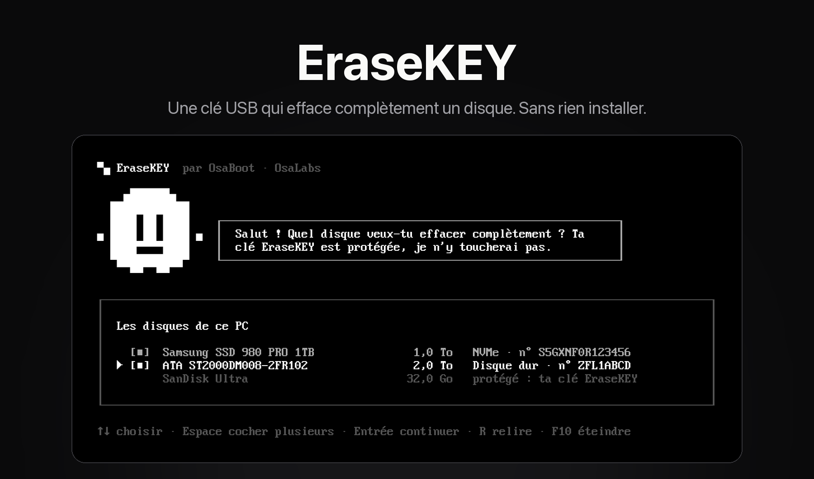
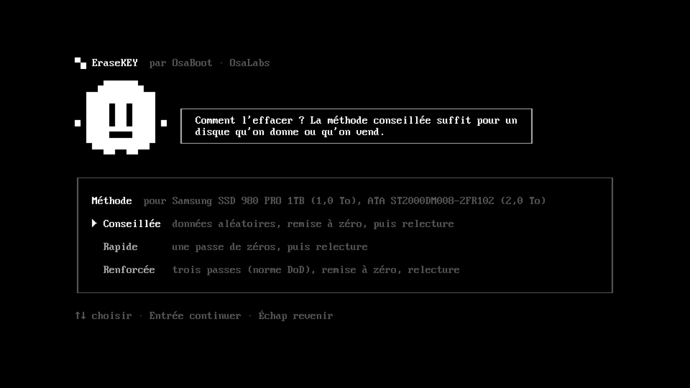
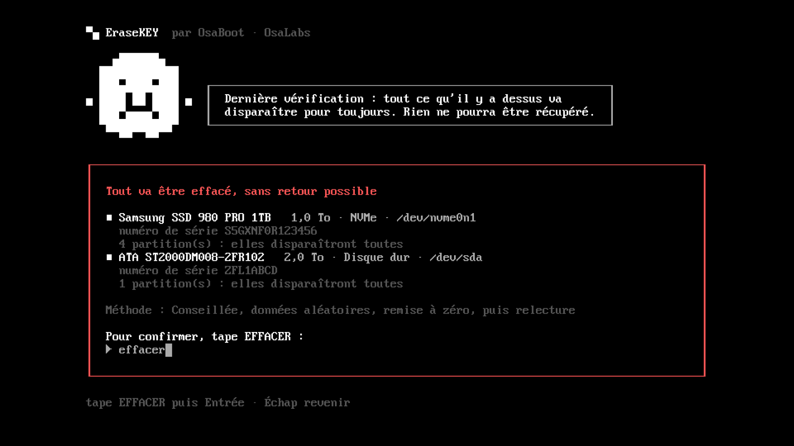
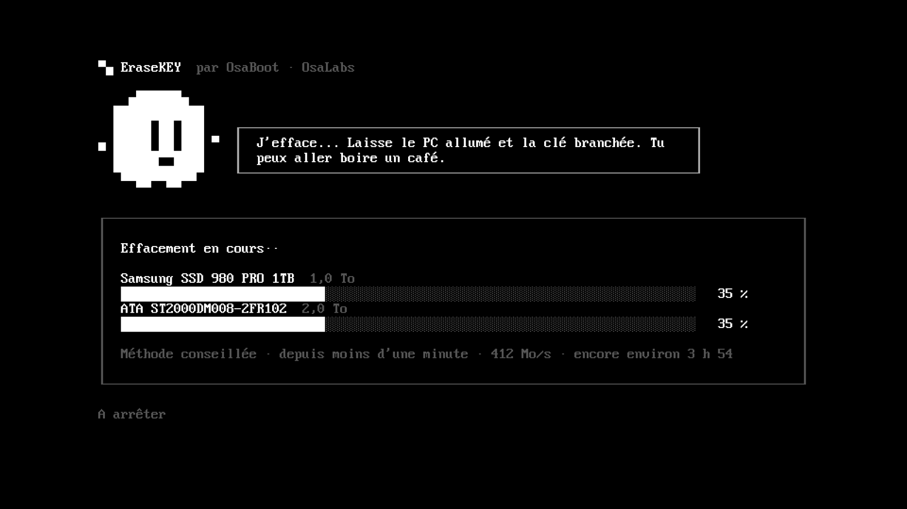
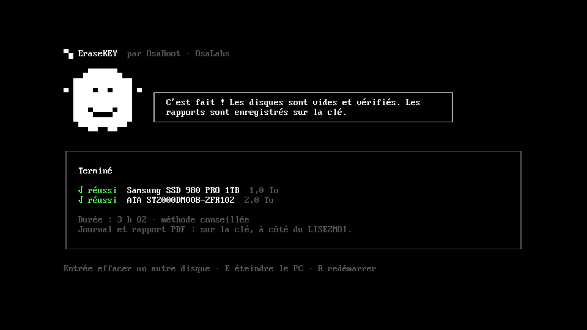

<p align="center">
  
</p>

<p align="center">
  <b>Une clé USB qui démarre un PC et efface complètement ses disques.</b><br>
  En français, en cinq étapes, sans rien installer.
</p>

<p align="center">
  <a href="https://osalabs.fr/erasekey">Site</a> ·
  <a href="https://github.com/osayanis/osaboot/releases/latest/download/OsaBoot.dmg">Créer une EraseKEY (OsaBoot pour Mac)</a> ·
  <a href="https://github.com/osayanis/osaboot">OsaBoot</a>
</p>

---

Tu donnes ou tu vends un vieux PC ? Supprimer les fichiers ne suffit pas : ils se récupèrent. EraseKEY réécrit **tout le disque**, puis le relit pour le vérifier. Elle te laisse un **rapport PDF** de l'effacement sur la clé.

Branche la clé, démarre le PC dessus, et tu arrives directement sur l'écran ci-dessus. Pas de menu, pas de ligne de commande, pas de Windows à lancer.

## Comment on l'utilise

| | |
|---|---|
| **1. Choisis le disque** | La liste montre les disques du PC, avec leur modèle, leur taille et leur numéro de série. Ta clé EraseKEY et les disques utilisés par le système sont grisés : impossible de les cocher. |
| **2. Choisis la méthode** | **Conseillée** : données aléatoires, remise à zéro, relecture. **Rapide** : une passe de zéros, relecture. **Renforcée** : trois passes (norme DoD), remise à zéro, relecture. |
| **3. Tape EFFACER** | La mascotte rappelle ce qui va disparaître : modèle, numéro de série, nombre de partitions. Rien ne démarre tant que le mot n'est pas tapé. |
| **4. Laisse faire** | Avancement par disque, débit, temps restant. `A` arrête, après une confirmation (`O`). |
| **5. C'est fait** | Résultat par disque. Le journal et un **rapport PDF par disque** sont enregistrés sur la clé. `E` éteint le PC, `R` le redémarre. |

<p align="center">
  
  
  
  
</p>
<p align="center"><sub>Vraies captures de l'interface, en mode démo dans une machine virtuelle 1920×1080 : rien n'y est effacé.</sub></p>

## Créer une EraseKEY

Avec **[OsaBoot](https://github.com/osayanis/osaboot)**, l'app Mac d'OsaLabs pour créer des clés de démarrage :

1. Ouvre OsaBoot et clique sur **« ou crée une EraseKEY »**.
2. Branche une clé USB de 256 Mo ou plus. **Prends une clé de marque** : les clés génériques lâchent souvent.
3. Clique sur **Créer l'EraseKEY**. OsaBoot télécharge ShredOS, prépare la clé, l'écrit, puis la relit en entier pour vérifier.

Sur le PC à effacer, démarre sur la clé (F12, F11, F8 ou Échap selon la marque). **Désactive le Secure Boot** dans le BIOS : ShredOS n'est pas signé pour.

## Ce qu'il y a dedans

EraseKEY ne réinvente pas l'effacement. Elle met une interface claire sur des outils éprouvés :

- **[ShredOS](https://github.com/PartialVolume/shredos.x86_64)** : un mini Linux qui démarre depuis une clé, sur n'importe quel PC x86-64, en UEFI comme en BIOS.
- **[nwipe](https://github.com/martijnvanbrummelen/nwipe)** : le moteur d'effacement (l'héritier de DBAN). C'est lui qui écrit, vérifie et génère les rapports PDF.
- **L'interface EraseKEY** (ce dépôt) : un programme **Go** avec [Bubble Tea](https://github.com/charmbracelet/bubbletea) et [Lip Gloss](https://github.com/charmbracelet/lipgloss). Il fait environ 3,5 Mo, statique, sans dépendance. Il lance nwipe en mode automatique et suit l'avancement dans `/proc/diskstats`.

OsaBoot assemble le tout au moment de créer la clé :

```
ShredOS officiel (téléchargé, empreinte vérifiée)
  └─ clé reconstruite au format standard : partition active au secteur 2048,
     FAT32 formaté par macOS, code de démarrage BIOS de GRUB conservé
       ├─ menu GRUB caché (Échap pendant 1 s pour le voir)
       └─ boot/osa.cpio.gz : petit initrd chargé après le noyau
            ├─ /usr/bin/osa-erase        l'interface (ce dépôt)
            └─ /usr/bin/nwipe_launcher   le lanceur de ShredOS, qui lance osa-erase
                                         à la place de l'écran de nwipe
```

Rien de ShredOS n'est recompilé : les fichiers de l'initrd remplacent simplement ceux du système au démarrage.

### Les petits détails

- **Deux sécurités pour la clé** : elle est exclue de la liste par ShredOS, puis une deuxième fois par l'interface (`/boot_device.txt`). Les disques montés par le système sont protégés aussi.
- **Écrans haute définition** : la police de la console Linux reste minuscule en 1920×1080. L'interface lit la police, double chaque pixel (8×16 devient 16×32) et la remet, seulement si tout tient encore à l'écran.
- **Police de console** : la console n'a que les caractères de l'ancienne page de code PC. Pas de bordures arrondies ni de ✓ : la mascotte est dessinée en blocs `█ ▀ ▄`.
- **Écran noir sur un PC ?** Appuie sur Échap juste après avoir choisi la clé : le menu réapparaît, avec une option de secours (`nomodeset`).

## Développer

```sh
# aperçu texte d'un écran, sur ton Mac, sans PC à effacer
go run . --render=disques        # methode | confirmation | effacement | fin

# l'interface en vrai dans un terminal, avec de faux disques et un faux effacement
OSA_DEMO=1 go run .

# l'initrd pour ShredOS (Go nécessaire), dans build/erasekey-overlay.cpio.gz
./build-overlay.sh
```

`build-overlay.sh` compile `osa-erase` pour Linux x86-64 et télécharge le lanceur de la version de ShredOS qu'utilise OsaBoot (`SHREDOS_TAG`). Il le retouche, puis refuse de continuer si le lanceur ne ressemble plus à ce qu'il connaît.

Pour tester sans PC : QEMU démarre très bien une EraseKEY (`-device usb-storage`), en BIOS ou en UEFI (OVMF). Ajoute `-device VGA,edid=on,xres=1920,yres=1080` pour voir le gros texte.

## Testé

- Machines virtuelles QEMU, en BIOS et en UEFI. Un disque de 4 Go en est ressorti entièrement à zéro (vérifié octet par octet), avec ses rapports PDF sur la clé.
- **Dell Latitude 5175** (UEFI, Secure Boot désactivé) : démarre directement sur l'interface et efface un vrai disque.

Les PC x86 64 bits seulement : pas les Mac Apple Silicon, ni les PC ARM.

## Licences

L'interface EraseKEY est d'OsaLabs ([Yanis](https://yanis.pro)), code public.
ShredOS et nwipe sont sous licence **GPL v2**, © PartialVolume et les contributeurs de nwipe. OsaBoot les télécharge depuis leurs releases officielles et ne les embarque pas. Le lanceur `nwipe_launcher` est une copie modifiée de celui de ShredOS (GPL v2) : seule la ligne qui lance nwipe change, voir `build-overlay.sh`.

<sub>Ce dépôt est la version autonome du dossier <code>erasekey/</code> d'<a href="https://github.com/osayanis/osaboot">OsaBoot</a>, qui sert à fabriquer les clés.</sub>
